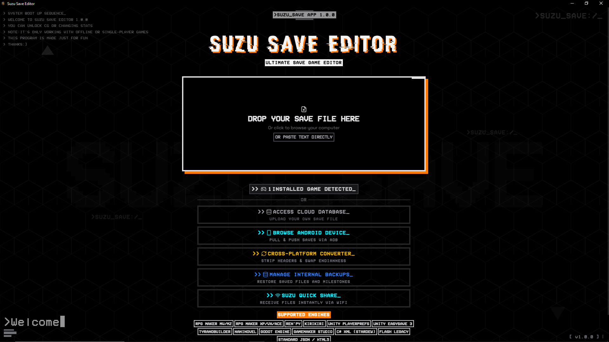
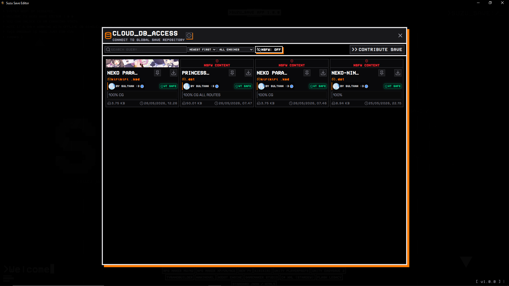
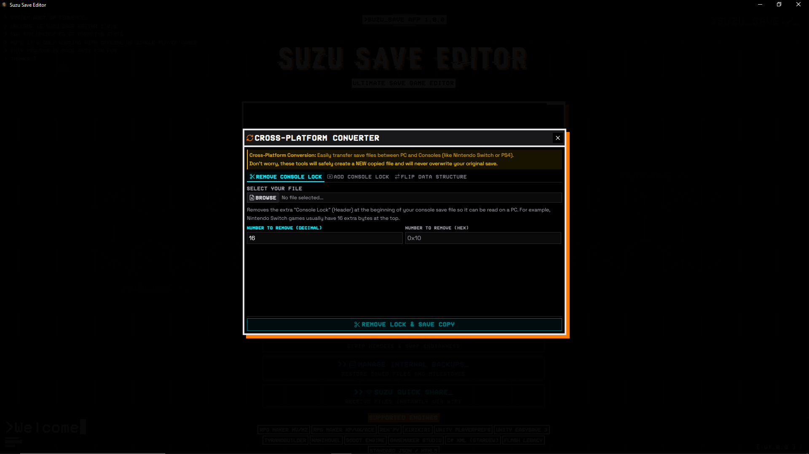
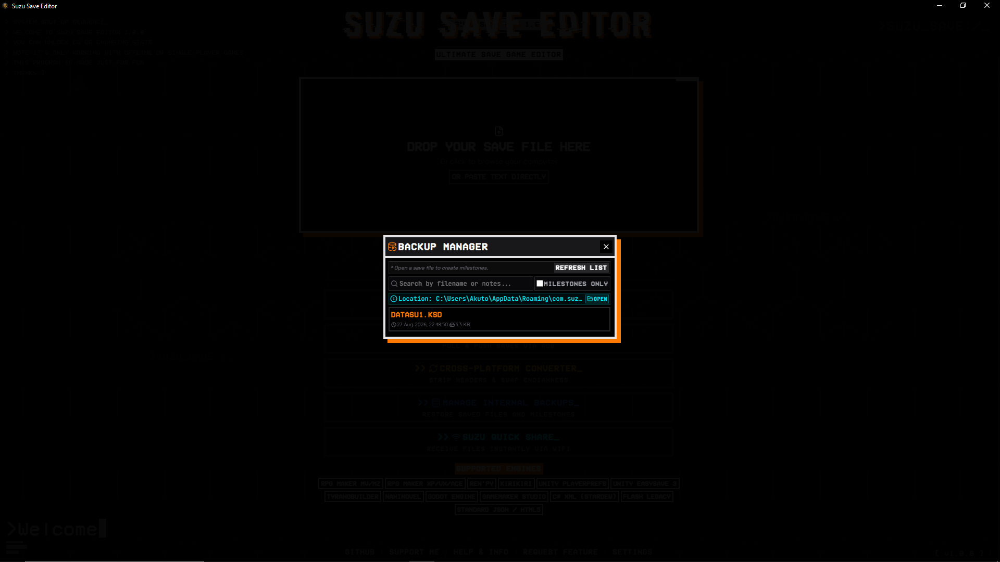
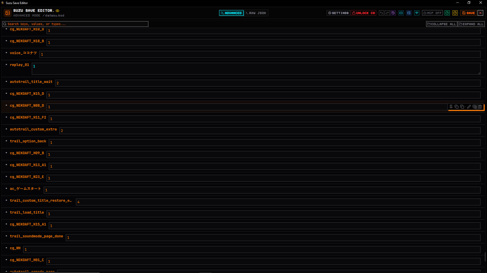
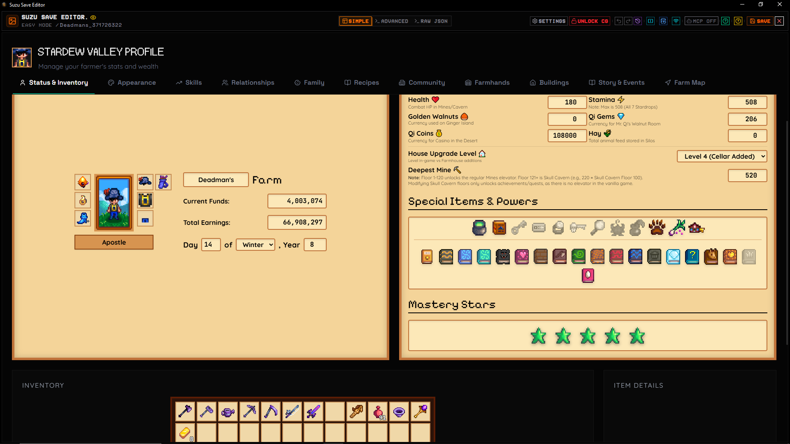
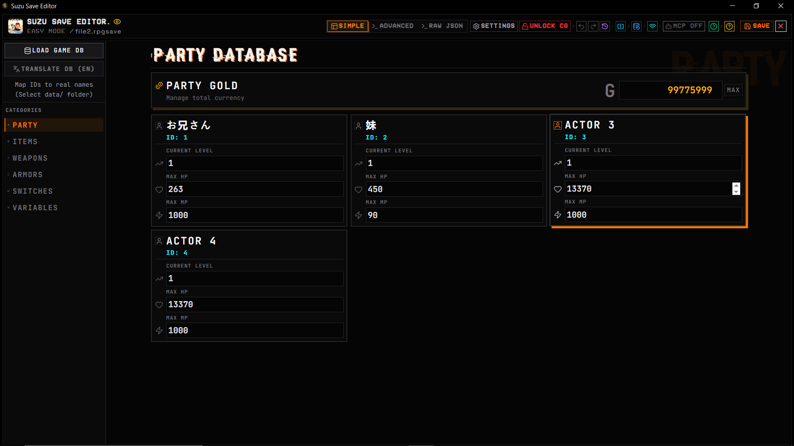
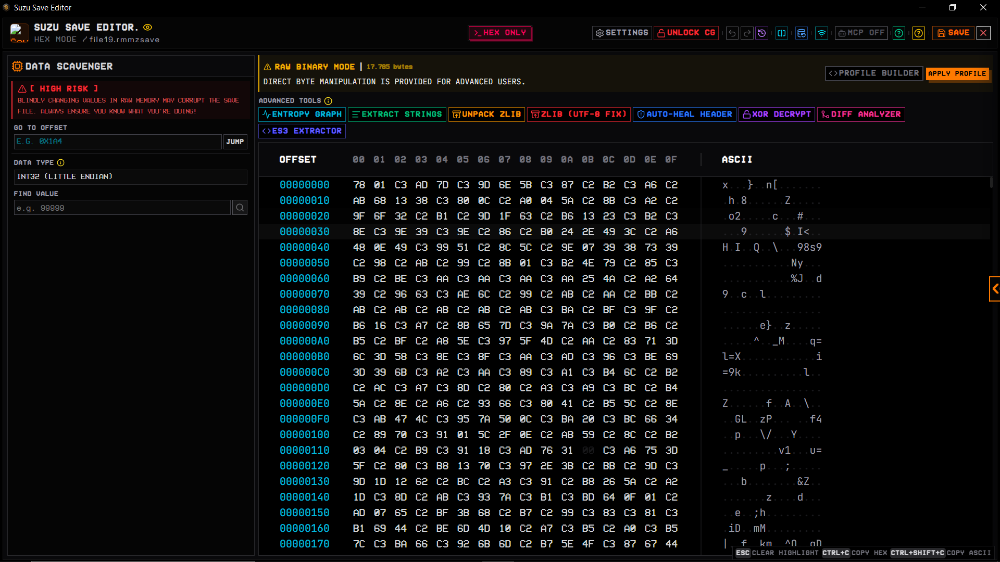

<div align="center">
  
  <h1>Suzu Save Editor</h1>
  <p><b>Free, Open-Source, and Offline Save Game Manager & Editor</b></p>

  <p>
    
    
    
    
    
    
  </p>
</div>

---

## Overview

**Suzu Save Editor** is a fast, lightweight, and cross-platform save game manager tailored for RPGs, Visual Novels, and JSON-based save files. It allows you to tweak stats, edit raw memory data, and transfer saves seamlessly across desktop and mobile devices.

---

## Key Features

- **High Performance & Lightweight:** Built with Rust and Tauri v2 for minimal RAM usage and rapid execution.
- **Cross-Platform Support:** Native support for **Windows**, **Linux**, and **Android**.
- **Local Sync & ADB Support:**
  - **Quick Share LAN:** Wirelessly transfer save files across local devices using a 4-digit PIN or QR code.
  - **Android ADB Integration:** Direct access to pull and push save files without manual USB file copying.
  - **Shizuku / SAF Integration:** Edit saves directly inside `Android/data` on Android 11+ without root.
- **Advanced Editing Suite:**
  - **Tree-View JSON & Hex Editors:** Virtualized rendering for massive save files, key pinning, inline editing, and memory scanning.
  - **Visual Diff & Memory Mapping:** Compare two save files side-by-side to highlight changed bytes.
  - **Reverse Engineering Toolkit:** Built-in pattern scanning, entropy calculation, Zlib decompression, XOR decryption, and magic header repair.
- **Special Game Engines & Tools:**
  - **Visual Novel CG Unlocker:** Automatically scan game folders or import community profiles to unlock CG galleries.
  - **Stardew Valley Engine:** Dedicated visual dashboard for farm layouts, inventory, animals, and relationship states.
  - **RPG Maker Auto-Translator:** Translate foreign items, weapons, and variables into English on the fly.
  - **Cross-Console Converter:** Convert save files between PC, Nintendo Switch, PS4, and Wii.
- **Model Context Protocol (MCP) & AI Integration:** Embedded local server allowing AI assistants (e.g., Claude Desktop, Cursor) to inspect and edit save files safely using 20+ specialized tools.

---

## Modding & Plugins

Create custom save parsers for unsupported games using our flexible Plugin Engine. We support:
- **Lua**
- **WebAssembly (Extism)**
- **Kaitai Struct**

Check out the **[Modder Guide](docs/modding/README.md)** to start building custom parsers.

---

## Tech Stack

- **Frontend:** SolidJS, Vite, Tailwind CSS v4, Monaco Editor
- **Framework:** Tauri v2
- **Backend & Systems:** Rust, Axum (Embedded Web Server)
- **Database & Auth:** Supabase

---

## Getting Started

### Prerequisites
- [Node.js](https://nodejs.org/) (v18+)
- [Rust Toolchain](https://rustup.rs/)
- Platform build dependencies (MSVC for Windows, WebKitGTK for Linux)

### Desktop Development

```bash
# Install dependencies
npm install
npm i -D @tauri-apps/cli@latest

# Run in development mode
npm run tauri dev

# Build production executable
npm run tauri build
```

### Android Build

```bash
# Run on connected Android device/emulator
npm run tauri android dev

# Build release APK
npm run tauri android build
```

> **Note for Android:** Ensure `ANDROID_HOME` and `NDK_HOME` environment variables are properly configured. Set up a local `keystore` for signing release builds to support LAN Quick Share capabilities.

---

## Preview

<details>
  <summary><b>Click to expand screenshots</b></summary>
  <br>
  <div align="center">
    <br><br>
    <br><br>
    <br><br>
    <br><br>
    <br><br>
    <br><br>
    <br><br>
    
  </div>
</details>

---

## License & Disclaimer

- **License:** Distributed under the **GNU General Public License v3.0 (GPL-3.0)**. See `LICENSE` for details.
- **Disclaimer:** *Use at your own risk.* Modifying save files can corrupt game data. Always create backups before editing!
